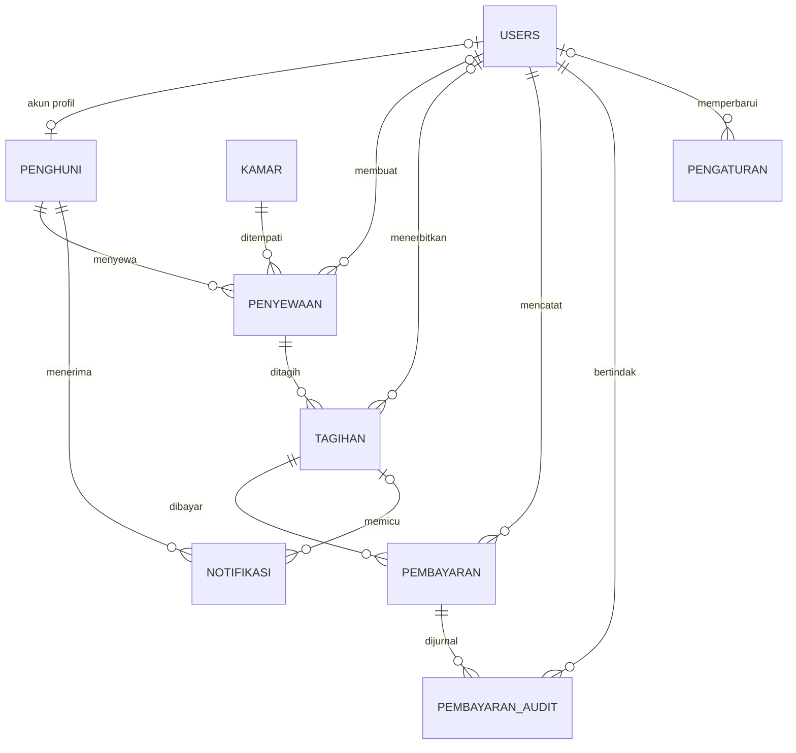

# Struktur akhir aplikasi dan database

| Lokasi | Isi |
|---|---|
| `kos-aron/*.php` | Enam halaman publik termasuk login, serta endpoint logout. |
| `admin/`, `penghuni/` | Halaman sesuai peran dan komponen navigasi masing-masing. |
| `includes/` | Bootstrap, sesi, otorisasi, CSRF, koneksi PDO, pemformatan, unggahan dan layout publik. |
| `data/` | Kueri dan transaksi kamar, penghuni, penyewaan, tagihan, pembayaran, notifikasi, laporan dan pengaturan. |
| `assets/` | CSS, JavaScript vanilla, gambar antarmuka dan direktori foto. |
| `database/` | Skema, migrasi bertahap, fixture uji, CLI penyiapan admin, pemeriksaan koneksi dan pengingat. |
| `docs/` | Dokumentasi, audit, instrumen SUS kosong dan riwayat pengembangan. |
| `scripts/` di root repositori | Pemeriksaan integrasi, pemeriksaan tampilan dan alat backup pengembangan. |

## ERD final

Satu tagihan dapat memiliki beberapa baris pembayaran sepanjang riwayat pembatalan. Pada satu waktu, indeks unik mengizinkan paling banyak satu pembayaran sah. Satu penghuni dan satu kamar masing-masing hanya dapat memiliki satu penyewaan aktif.

| Tabel | Kunci dan data |
|---|---|
| users | PK id, username unik, password_hash, role admin/penghuni, nama, status, last_login_at dan waktu perubahan. |
| kamar | PK id, nomor unik, harga DECIMAL(12,2), deskripsi, fasilitas dan galeri JSON, foto_utama, kondisi dan waktu perubahan. |
| penghuni | PK id, FK user_id unik opsional, nama, no_telepon, email, keterangan dan waktu perubahan. |
| penyewaan | PK id, FK penghuni_id, kamar_id, dibuat_oleh, harga_sewa_disepakati, hari_jatuh_tempo 1–31, tanggal masuk/keluar, status, keterangan dan waktu perubahan. Kolom generated berindeks unik menjaga kamar dan penghuni aktif. |
| tagihan | PK id, FK penyewaan_id dan dibuat_oleh, periode YYYY-MM, jumlah, jatuh_tempo, keterangan dan waktu perubahan. Unik per penyewaan dan periode. |
| pembayaran | PK id, FK tagihan_id dan dicatat_oleh, tanggal_bayar, nominal_dibayar, metode, keterangan, status dan waktu perubahan. Kolom generated tagihan_aktif_unik menjaga satu pembayaran sah. |
| pembayaran_audit | PK id, FK pembayaran_id dan admin_id, aksi, waktu, alasan, sebelum dan sesudah dalam JSON. |
| notifikasi | PK id, FK penghuni_id dan tagihan_id, tipe, peristiwa, judul, pesan, tanggal, dibaca, dibaca_pada dan created_at. Kombinasi tagihan, tipe dan peristiwa unik. |
| pengaturan | PK kunci, nilai, updated_at dan FK updated_oleh. Nilai publik meliputi nama, deskripsi, alamat, kontak, Maps dan nama file foto. |

Definisi kolom, tipe, indeks, aturan foreign key dan nilai default dapat diperiksa pada [skema SQL final](../database/schema.sql).

## Alur transaksi

- Admin menempatkan penghuni di kamar kosong. Transaksi membuka sewa dengan harga kesepakatan. Saat keluar, sewa ditutup dan akun dinonaktifkan. Profil, sewa dan transaksi lama dipertahankan.
- Admin memeriksa pratinjau tagihan, kemudian mengonfirmasi. Server memeriksa lagi periode serta status sewa dan melewati tagihan yang sudah ada. Pengingat CLI hanya membaca tagihan yang sudah diterbitkan.
- Admin mencatat penerimaan penuh. Sistem mengunci tagihan dan menyimpan pembayaran, audit dan informasi lunas. Status belum bayar atau terlambat berasal dari tanggal jatuh tempo selama tagihan belum memiliki pembayaran penuh yang sah. Laporan dan dashboard mengikuti relasi yang sama.
